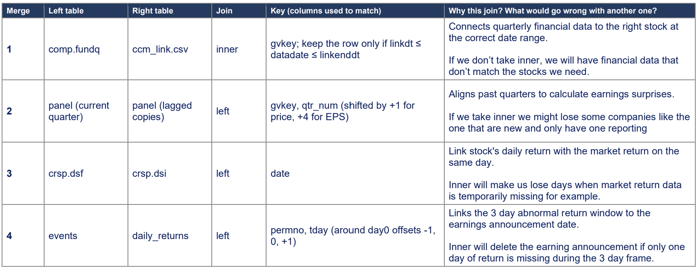

# Earnings Surprises & 3-Day Stock Reactions: Depository Institutions (SIC 60) vs. Electronic Equipment (SIC 36)

**Author:** Lucas Bergeal  
**Role / Context:** Analyst, Hogwarts Consulting (Engagement Lead: Harry Potter) — Project 3

## Research Question
Do larger quarterly earnings surprises (SUE) lead to higher 3-day abnormal stock returns (CAR) for Depository Institutions (SIC 60, client context: JPMorgan Chase & Co.) compared to Electronic Equipment (SIC 36) between 2021 and 2024?

## Main Result & Figure 1
High-surprise announcements earn higher average 3-day CARs than low-surprise announcements in both industries, with a much larger spread in Electronic Equipment (**+4.19 percentage points**, from **−2.01%** in Low SUE to **+2.18%** in High SUE) than in Depository Institutions (**+0.91 percentage points**, from **−0.13%** in Low SUE to **+0.78%** in High SUE).

## Statistical Tests, Regression & Figure 2
- **Welch's t-test (High vs. Low SUE):** The High-minus-Low gap is **+0.91 pp** in Depository Institutions (*t* = 4.58, *p* < 0.0001) and **+4.19 pp** in Electronic Equipment (*t* = 6.99, *p* < 0.0001), confirming that the group differences are statistically significant.
- **OLS Regression (CAR on SUE):** In the regressions (`car_w ~ sue`, using 1% / 99% winsorized CAR and decimal variables), the slope on SUE is positive in both industries (*b* = 0.0486, *p* = 0.0045 in SIC 60; *b* = 0.0733, *p* = 0.0542 in SIC 36; *R²* = 0.002 in both). A higher earnings surprise goes with a higher average 3-day return, while *R²* is small because 3-day stock returns reflect many factors beyond year-over-year EPS surprises.

## Industry Comparison & Explanation (Figure 3)
Electronic Equipment shows more than 4.5× the High-minus-Low spread of Depository Institutions and wider return swings (CAR standard deviation of 10.82% vs. 5.10%). Checking the share of loss-making quarters (`epspxq < 0`) across SUE groups shows that money-losing quarters are far more common in Electronic Equipment overall (**26.7%** vs. **2.5%** in Depository Institutions) and especially in the Low-SUE group (**46.1%** vs. **6.7%**). Frequent losses and higher earnings volatility in Electronic Equipment align with sharper stock reactions around announcements.

## Business Advice, Limitation & Next Questions
- **Advice for the client (JPMorgan Chase & Co.):** Benchmark bank announcement reactions against banking peers (~0.9 pp spread) rather than high-swing technology stocks, emphasize forward guidance on net interest income, credit quality, and capital plans, and treat loss quarters as a clear negative signal.
- **Key limitation:** Our SUE measure compares current EPS to the same quarter a year earlier rather than Wall Street analyst consensus forecasts, and *R²* is small—so historical SUE alone cannot predict individual stock moves.
- **Predictive Question (What will happen?):** Can combining Wall Street analyst surprises with earnings-call tone predict JPM's 3-day stock move better than past-year EPS alone?
  - *Extra Data Needed:* Analyst consensus EPS estimates (I/B/E/S) and JPM/peer earnings call transcripts.
- **Prescriptive Question (What should JPM do?):** Should JPM share mid-quarter updates on credit and interest income before uncertain quarters to reduce earnings-day swings?
  - *Extra Data Needed:* SEC Form 8-K filing timestamps and intraday trading volume & bid-ask spreads.

## Data Sources (Described, Not Shared)
No raw data, link files, company-level results, or WRDS credentials are stored in this repository.
- **CRSP / Compustat Merged link file (`ccm_link.csv`):** Used locally on WRDS JupyterHub to map `gvkey` to `permno` and `sic2` (not included in this repository).
- **Compustat Quarterly (`comp.fundq`):** Quarterly fundamentals (`gvkey`, `datadate`, `fyearq`, `fqtr`, `rdq`, `epspxq`, `prccq`) for `indfmt = 'INDL'`, `datafmt = 'STD'`, `popsrc = 'D'`, `consol = 'C'`.
- **CRSP Daily Stock & Market Files (`crsp.dsf`, `crsp.dsi`):** Daily stock returns (`ret`) and value-weighted market index returns (`vwretd`).

## Merge Map & Sample Rules
1. Filtered `ccm_link.csv` to `sic2 == '60'` and `sic2 == '36'`, merged with `comp.fundq` on `gvkey`, kept links valid at quarter-end (`linkdt <= datadate <= linkenddt`), and deduplicated on `(gvkey, datadate)`.
2. Built sequential quarter index `qtr_num = fyearq * 4 + fqtr`, matched lagged price (`prc_lag1`) at `qtr_num - 1` and lagged EPS (`eps_lag4`) at `qtr_num - 4`, and computed `SUE = (epspxq - eps_lag4) / prc_lag1`.
3. Kept announcements (`rdq`) from Jan 2021 to Dec 2024 with non-missing `rdq` and `SUE`, `prc_lag1 >= $5`, and `|SUE| <= 1`.
4. Merged daily stock returns with the CRSP trading calendar on `date` (`ar = ret - vwretd`), set `day0` as the first trading day with `date >= rdq`, summed `ar` over trading days `[-1, 0, +1]`, and kept events with all 3 trading days present.

## Changes Since Project 2
- **What was wrong / feedback:** Re-ran the Project 2 pipeline cleanly for SIC 60 and extended the exact same pipeline to comparison industry SIC 36, adding Welch's *t*-tests, winsorized OLS regressions, and cross-industry comparison figures.
- **How we fixed it:** Standardized data filtering, verified date/lag alignment and sample funnel counts, deduplicated `(gvkey, datadate)` keys (removing 3 duplicate rows in SIC 36), and checked winsorized vs. un-winsorized regressions.
- **How results changed:** Final sample sizes are **3,964** announcements for Depository Institutions (SIC 60) and **2,208** announcements for Electronic Equipment (SIC 36), with clear side-by-side comparisons across SUE tertiles.

## Where the Code Came From & AI Usage
Built from course lecture/assignment notebooks on CCM linking, SUE calculations, event-study CARs, *t*-tests, and OLS regressions in Python (`pandas`, `numpy`, `matplotlib`, `scipy`, `statsmodels`, `wrds`). Used AI assistance (including conversations in French) to structure the comparison workflow, check data types and merges, format plots, and refine presentation wording; all code and outputs were reviewed and executed end-to-end on WRDS JupyterHub.

## Repository Structure
- `README.md` — Project overview, findings, methodology, and changes log
- `notebook/Bergeal_Lucas_Project3.ipynb` — Executed Jupyter notebook with all outputs
- `figures/` — `Fig 1.png`, `Fig 2.png`, `Fig 3.png`, and `Table.png`
